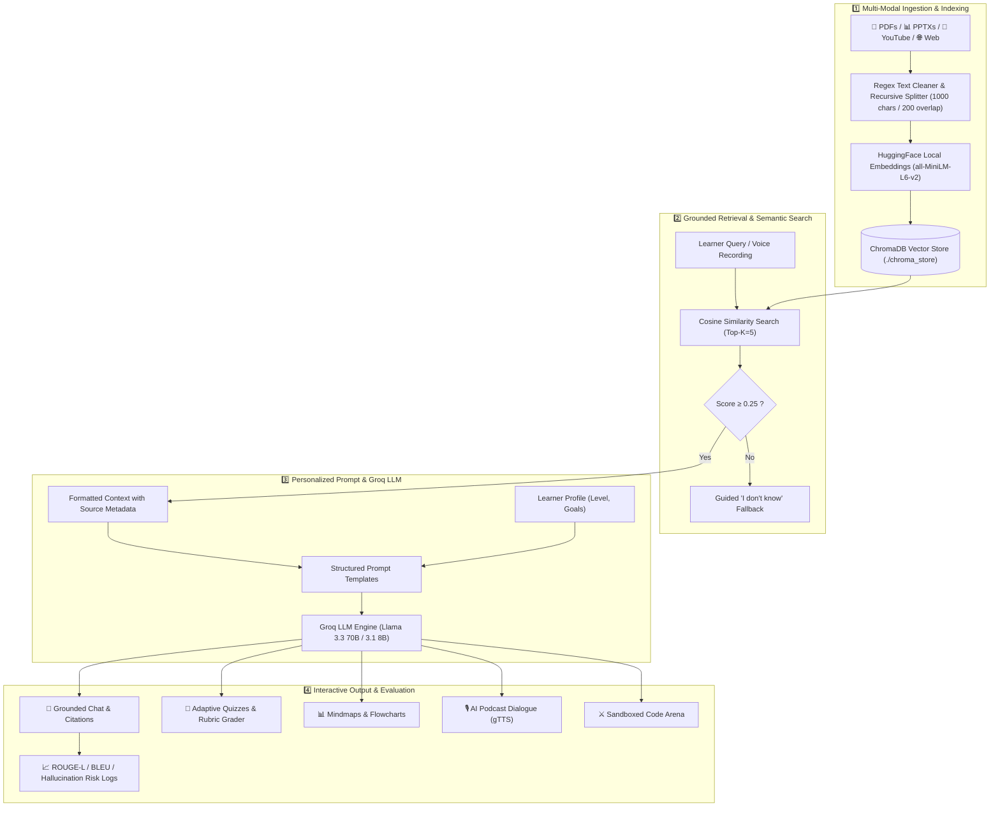

<div align="center">

# 🚀 NextGen Tutor AI

### **A Production-Ready Multimodal AI Tutoring & RAG Platform**

<p align="center">
  
  
  
  
</p>

<p align="center">
  
  
  
  
</p>

<p align="center">
  
  
  
  
</p>

<br/>

**NextGen Tutor AI** is an intelligent, adaptive e-learning ecosystem built with modern Retrieval-Augmented Generation (RAG) practices, Groq-accelerated LLMs, local HuggingFace embeddings, multimodal study tools, and a sandboxed coding arena.

---

</div>

## 📌 Project Overview

The **NextGen Tutor AI** is a production-inspired full-stack AI application designed to transform static course materials into an interactive, personalized learning journey.

The project combines:
- ⚛️ **Streamlit Frontend:** A reactive, multi-tab educational dashboard with voice input, audio playback, and visual diagram renderers.
- 🧠 **Groq LLM Engine:** Ultra-low latency inference using `openai/gpt-oss-120b` (deep reasoning) and `openai/gpt-oss-20b` (fast tasks).
- 🔍 **RAG Pipeline & ChromaDB:** Semantic document retrieval with local HuggingFace embeddings (`all-MiniLM-L6-v2`) and strict citation grounding.
- 📝 **Adaptive Micro-Quizzes:** Auto-generated MCQs and short-answer questions with rubric-based grading, partial credit, and Socratic hints.
- ⚔️ **Coding Battle Arena:** In-browser IDE sandbox with test-case validation, AI code coaching, and timed contests.
- 🎙️ **Multimodal Study Aids:** Auto-generated flashcards, hierarchical mind maps, flowcharts, timelines, and two-host podcast audio scripts.
- 📊 **QA & Observability:** Live tracking of ROUGE-L, BLEU scores, hallucination risk indicators, and exportable session logs.

---

## ⚙️ How It Works (Core Architecture)

NextGen Tutor AI operates on a 4-tier pipeline that guarantees high accuracy, zero hallucination, and personalized educational feedback:



---

## 🔄 Detailed Workflows

### 1. 📥 Knowledge Ingestion & Indexing Workflow
1. **Upload:** Learner uploads course files (PDFs, PPTX slide decks) or inputs web/YouTube URLs.
2. **De-Duplication:** Each file is hashed via SHA-256 to ensure files already stored in ChromaDB are skipped.
3. **Cleaning & Splitting:** Text is cleaned (header/footer removal) and split into chunks of 1000 characters with 200-character overlap.
4. **Embedding:** `sentence-transformers/all-MiniLM-L6-v2` embeds each chunk into a 384-dimensional dense vector locally (no external API calls or cost).
5. **Persistence:** Chunks and vector embeddings are indexed into `./chroma_store` with rich metadata (document name, page number, upload timestamp).

---

### 2. 💬 Socratic Chat Tutor & Debate Workflow
1. **Question Input:** The user types a query or uses the microphone to record voice input (converted via SpeechRecognition).
2. **Retrieval & Threshold Check:** Top-5 most relevant chunks are retrieved. If maximum similarity score is `< 0.25`, the tutor safely replies that the material is missing rather than hallucinating.
3. **Personalization Conditioning:** The system prompt adapts explanations based on learner skill level:
   - *Beginner:* Simple language, metaphors, step-by-step analogies.
   - *Intermediate:* Technical context and core conceptual links.
   - *Advanced:* Deep derivations, trade-offs, and edge cases.
4. **Structured Answer:** Groq generates a 6-section answer: **Answer**, **Key Concepts**, **Example**, **Common Mistakes**, **Citations (Doc & Page)**, and **What to Learn Next**.
5. **Debate Mode:** When toggled, the AI acts as a Socratic "Devil's Advocate" to challenge student assumptions and prompt critical thinking.

---

### 3. 📝 Adaptive Quiz & AI Rubric Grading Workflow
1. **Generation:** Generates a 5-question micro-quiz directly derived from the current study topic (60% MCQ, 40% Short Answer).
2. **Student Attempt:** The learner selects MCQ choices and writes text answers for open-ended questions.
3. **Intelligent Rubric Grading:** The AI evaluates conceptual accuracy on a continuous scale (`0.0` to `1.0`), awarding partial credit and explaining mistakes.
4. **Socratic Hints:** If stuck, learners can request conceptual hints that guide reasoning without giving away answers.

---

### 4. 📊 Visual Learning & Podcast Generation Workflow
- **Mind Maps:** Converts course topics into hierarchical JSON trees, rendered visually with Mermaid.js.
- **Flowcharts & Timelines:** Synthesizes procedural workflows and chronological milestones into interactive diagrams.
- **AI Podcast Studio:** Transforms study logs into a two-host script between **Alex** (expert tutor) and **Sam** (curious student), rendered to playable/downloadable audio using `gTTS`.

---

### 5. ⚔️ Coding Battle Arena Workflow
1. **Problem Synthesis:** Algorithmic challenges are created dynamically based on course topics, complete with visible and hidden test suites.
2. **In-Browser IDE:** Built with `streamlit-ace` supporting Python and JavaScript with syntax highlighting.
3. **Sandboxed Subprocess Execution:** Code is executed in an isolated environment with restricted modules (blocking OS, network, and file system tampering) and a 5-second timeout.
4. **AI Code Coach:** Offers 3 tiers of assistance: Socratic hint, comprehensive code review (time/space complexity), or full reference solution.
5. **Timed Contests:** Leaderboard tracking with countdown timers and attempt penalties.

---

### 6. 🛡️ Quality Assurance & Hallucination Prevention Workflow
1. **Grounding Guardrails:** System prompts forbid speculation outside retrieved materials.
2. **Lexical Overlap Heuristic:** Computes token intersection between generated answer and source context; flags low overlap with a visual warning badge.
3. **Automated Proxy Metrics:** Calculates real-time **ROUGE-L** (Longest Common Subsequence) and **BLEU** scores.
4. **Audit Logging:** Every prompt, response, metric score, and quiz result is recorded to `./logs/interactions.jsonl` (exportable to CSV/JSON).

---

## ✨ Key Features Summary

| Module | Purpose & Capabilities |
| :--- | :--- |
| **⚙️ Knowledge Base** | Ingest PDFs, PPTX slides, YouTube video transcripts, and web URLs with SHA-256 de-duplication. |
| **💬 Socratic Chat Tutor** | Accurate answers with mandatory source citations (Doc Name · Page Number · Snippet) and voice input. |
| **🗣️ Debate Mode** | Socratic "Devil's Advocate" partner that challenges learner reasoning using course context. |
| **📝 Adaptive Quizzes** | Context-aware MCQ & short-answer generation with continuous rubric grading and step-by-step hints. |
| **📇 Flashcards Studio** | Interactive term-definition flip-cards with spaced repetition and PDF export. |
| **📊 Visual Learning** | Auto-generated Mermaid.js mind maps, procedural flowcharts, and chronological timelines. |
| **🌐 URL & YouTube Ingestion** | Extract and summarize blogs (`trafilatura`) or YouTube videos (`youtube-transcript-api`) in 7 summary styles. |
| **🎙️ AI Podcast Studio** | Converts lecture transcripts into two-host conversational scripts (Alex & Sam) with downloadable MP3 audio. |
| **⚔️ Coding Battle Arena** | In-browser code editor (`streamlit-ace`), isolated test runner, AI code coach, and timed contests. |
| **📈 Insights & Analytics** | Interactive score history, proxy RAG evaluation metrics (ROUGE-L, BLEU), and hallucination risk alerts. |
| **🌍 Multilingual Support** | Instant translation into 16 global languages (Hindi, Spanish, French, Telugu, Tamil, etc.). |

---

## 🛠️ Tech Stack

| Category | Technology | Purpose |
| :--- | :--- | :--- |
| **Frontend** | Streamlit 1.30+ | Reactive UI, tabs, session state management |
| **LLM Engine** | Groq API (`openai/gpt-oss-120b`, `openai/gpt-oss-20b`) | Fast inference for reasoning, quiz generation, grading |
| **Embeddings** | HuggingFace (`all-MiniLM-L6-v2`) | Local 384-dim dense vector generation (zero cost) |
| **Vector DB** | ChromaDB | Persistent local semantic vector storage (`./chroma_store`) |
| **Orchestration** | LangChain | Document loaders, text splitters, prompt templates |
| **Code Sandbox** | Streamlit-Ace & Subprocess Runner | In-browser IDE, test case validation, import security filter |
| **Audio & Speech** | gTTS & Audio Recorder Streamlit | Voice input transcription and text-to-speech rendering |
| **Evaluation** | rouge-score & nltk (BLEU) | Automated hallucination detection and response quality scoring |
| **Containerization** | Docker | Production container image with mounted storage |

---

## 📁 Project Structure

```
nexgen-tutor/
├── app.py                  # Main Streamlit application orchestrating all 10 tabs
├── config.py               # Centralized configuration & prompt templates
├── Dockerfile              # Production Docker container image definition
├── requirements.txt        # Python package dependencies
├── Project_Report.md       # Academic project report & architectural specifications
├── README.md               # Project documentation & user guide
│
├── rag/                    # ── RAG Pipeline Subsystem
│   ├── ingest.py           # Document cleaning, chunking & ChromaDB storage
│   ├── retriever.py        # Semantic similarity search with score thresholding
│   ├── chain.py            # Conversational QA chain with Groq LLM integration
│   ├── media_ingest.py     # PPTX, plain text & image extraction
│   └── url_ingest.py       # Web scraping (Trafilatura) & YouTube transcripts
│
├── tutor/                  # ── Pedagogical AI Engines
│   ├── personalize.py      # Learner profile & skill adaptation
│   ├── quiz.py             # Micro-quiz generator (MCQ + Short Answer)
│   ├── grader.py           # Rubric-based AI grading with partial credit
│   ├── debate.py           # Socratic "Devil's Advocate" debate engine
│   ├── flashcards.py       # Flashcard deck generator with PDF export
│   ├── mindmap.py          # Hierarchical recursive mind map builder
│   ├── podcast.py          # Two-host podcast script & show notes generator
│   └── translator.py       # Multilingual translation engine (16 languages)
│
├── visual/                 # ── Diagram & Visualization Generators
│   ├── flowchart_generator.py # Procedural workflow Mermaid flowchart builder
│   └── timeline_generator.py  # Chronological milestone Mermaid timeline builder
│
├── arena/                  # ── Sandboxed Coding Battle Arena
│   ├── problem_engine.py   # Grounded problem generator with hidden test suites
│   ├── executor.py         # Subprocess execution sandbox with security filters
│   ├── coach.py            # AI code mentor (hints, review, reference solutions)
│   ├── contest.py          # Timed contest manager & submission queue
│   └── models.py           # Dataclasses for problems, submissions & leaderboards
│
├── eval/                   # ── Quality Assurance & Logging
│   ├── metrics.py          # ROUGE-L, BLEU & hallucination risk calculators
│   └── logger.py           # JSONL session logger & CSV/JSON export utilities
│
├── chroma_store/           # Persistent ChromaDB vector database index files
└── logs/                   # Local interaction and quiz performance history
```

---

## ⚡ Quick Start

### 1. Prerequisites
- Python 3.10+
- Free **Groq API Key** from [console.groq.com](https://console.groq.com)

---

### 2. Local Installation

```bash
# 1. Clone repository
git clone https://github.com/eekshitaandhavarapu/nexgen-tutor.git
cd nexgen-tutor

# 2. Create virtual environment
python3 -m venv .venv
source .venv/bin/activate    # On Windows: .\.venv\Scripts\Activate.ps1

# 3. Install dependencies
pip install --upgrade pip
pip install -r requirements.txt

# 4. Run the app
streamlit run app.py
```

Open **http://localhost:8501** in your browser.

---

### 3. Docker Deployment 🐳

```bash
# Build Docker image
docker build -t nexgen-tutor .

# Run container with persistent storage
docker run -p 8501:8501 \
  -v $(pwd)/chroma_store:/app/chroma_store \
  -v $(pwd)/logs:/app/logs \
  nexgen-tutor
```

---

## ⚙️ Configuration (`.env`)

You can create an optional `.env` file in the root folder:

```env
# Groq API Configuration
GROQ_API_KEY=gsk_your_key_here
GROQ_MODEL=openai/gpt-oss-120b
GROQ_FAST_MODEL=openai/gpt-oss-20b
TEMPERATURE=0.3

# RAG Parameters
CHUNK_SIZE=1000
CHUNK_OVERLAP=200
TOP_K=5
SCORE_THRESHOLD=0.25

# Vector Store
EMBEDDING_MODEL=all-MiniLM-L6-v2
CHROMA_COLLECTION=nexgen_tutor
```

---

## 📜 License

This project is open source and available under the [MIT License](LICENSE).

<div align="center">
  <sub>Built with ❤️ by <a href="https://github.com/eekshitaandhavarapu">Eekshita Andhavarapu</a></sub>
</div>

### Chat error: model does not exist

The previous Llama defaults and Qwen/Scout dropdown options were retired for
Groq free/developer accounts in July–August 2026. The defaults now use
`openai/gpt-oss-120b` for tutoring and `openai/gpt-oss-20b` for fast tasks.
These models still use your **Groq API key**.

If you have an existing `.env` or deployment environment, update or remove
old `GROQ_MODEL` and `GROQ_FAST_MODEL` overrides:

```dotenv
GROQ_MODEL=openai/gpt-oss-120b
GROQ_FAST_MODEL=openai/gpt-oss-20b
```

Restart/reboot the Streamlit app, then select `openai/gpt-oss-120b` in Setup.
If access is still denied, check your Groq organization's model permissions.
See [Groq model deprecations](https://console.groq.com/docs/deprecations)
and [currently supported models](https://console.groq.com/docs/models).
